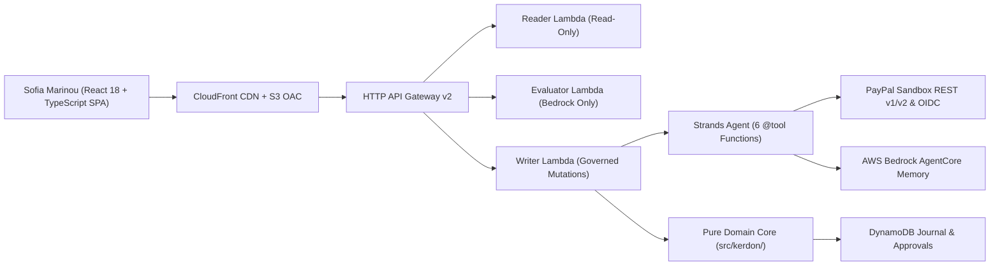
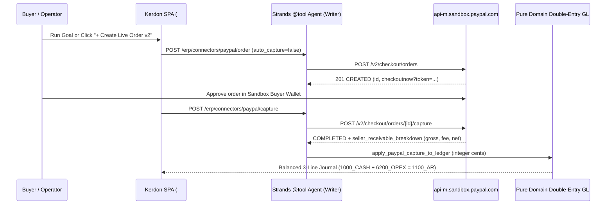

# Kerdon PayPal Edition: Autonomous Agentic Commerce & Double-Entry Mini-ERP

[](https://github.com/upgradedev/kerdon-paypal-erp/actions/workflows/ci.yml)
[](LICENSE)

**Live PayPal Developer Platform (`api-m.sandbox.paypal.com`) + Strands Agents SDK (`@tool`) + Deterministic Double-Entry General Ledger**

Kerdon PayPal Edition turns multi-store SMB and financial back-office operations into a governed Agentic Commerce loop. Instead of letting an LLM guess balances or trigger unchecked payouts, Kerdon pairs a **6-tool Strands Agents SDK + Amazon Bedrock Nova Pro copilot** (`src/kerdon_aws/paypal_agent_tools.py`) with a **zero-SDK deterministic integer-cent System of Record** (`src/kerdon/`) and **8 live PayPal Developer Platform capabilities** (`src/kerdon_aws/paypal_live_client.py`).

> **Core Problem & Named Persona (`Sofia Marinou`, FinOps Director):** Multi-store merchants and financial back-offices lose margin and audit integrity across disconnected PayPal checkouts, unbooked payment processing fees, chargeback disputes, seller commission clawbacks, and manual batch disbursements. Sofia Marinou uses Kerdon to create live PayPal `Orders v2`, reconcile `seller_receivable_breakdown` fees into balanced 3-line General Ledger entries (`1000_CASH + 6200_OPEX = 1100_AR`), provision recurring SaaS `Subscriptions v1`, assemble SHA-256 `Disputes v1` evidence packets, link verified merchant identities via `Log in with PayPal` (OIDC v1.1), and enforce Four-Eyes Segregation of Duties on `Batch Payouts v1`.

---

## 1. Live PayPal Developer Platform Capabilities (`https://api-m.sandbox.paypal.com`)

| # | PayPal API / Capability | Endpoint(s) | Implementation & Accounting Governance |
|---|---|---|---|
| 1 | **OAuth 2.0 Client Credentials & Scope Introspection** | `POST /v1/oauth2/token` | Live token exchange + `app_id` and granted scope verification (`POST /erp/connectors/verify`). |
| 2 | **Log in with PayPal (OpenID Connect v1.1)** | `GET /signin/authorize`, `GET /v1/identity/oauth2/userinfo?schema=paypalv1.1` | Verifies merchant `payer_id`, primary email, and `verified_account` status (`src/kerdon_aws/paypal_live_client.py`). |
| 3 | **Checkout Orders v2 (2-Step Create -> Buyer Approval -> Capture)** | `POST /v2/checkout/orders`, `GET /v2/checkout/orders/{id}`, `POST .../capture` | Creates live `CREATED` order with `checkoutnow?token=...` approval link; fails closed (`HTTP 502` + `paypal_debug_id`) on `ORDER_NOT_APPROVED`; posts balanced 3-line GL split (`DR 1000_CASH + DR 6200_OPEX = CR 1100_AR`) upon `COMPLETED` capture. |
| 4 | **Catalog Products v1, Billing Plans v1 & Subscriptions v1** | `POST /v1/catalogs/products`, `POST /v1/billing/plans`, `POST /v1/billing/subscriptions` | Provisions recurring EUR SaaS plans (`PROD-...` -> `P-...` -> `I-...`) with live subscriber `ba_token` approval URLs. |
| 5 | **Batch Payouts v1 + Status Read-Back** | `POST /v1/payments/payouts`, `GET /v1/payments/payouts/{id}` | Enforces Four-Eyes (`approver_id != executor_id`), Beneficiary Binding, Reserve Floor, and SHA-256 Changed-Evidence invalidation; fails closed (`HTTP 502` + `paypal_debug_id`, keeping approval `VALID`) on `INSUFFICIENT_FUNDS`. |
| 6 | **Customer Disputes v1 & Autonomous Defense Packet** | `GET /v1/customer/disputes` | Syncs live seller disputes and assembles `PROOF_OF_FULFILLMENT` packets cross-referencing SHA-256 invoice bytes, tax `MARK`, and warehouse dispatch while posting deterministic `ClawbackEvent` entries. |
| 7 | **Order Shipment Tracking v1** | `POST /v1/shipping/trackers-batch` | Attaches carrier tracking (`DHL`) to settled PayPal captures for seller-protection proof. |
| 8 | **Webhooks v1 Registration & Signature Verification** | `GET/POST /v1/notifications/webhooks`, `POST /v1/notifications/verify-webhook-signature` | Registers webhook subscriptions, verifies signatures + replay-deduplicates `event_id`, and routes `CHECKOUT.ORDER.APPROVED` and `BILLING.SUBSCRIPTION.ACTIVATED`. |

---

## 2. System Architecture & Agentic Commerce Flow





---

## 3. Repository Structure & Verification Suite

- `src/kerdon/`: Pure Python 3.12 Hexagonal Domain Core (zero cloud, network, or LLM SDK imports, enforced by AST Gate `A5` in `scripts/verify_gates.py`). Includes `src/kerdon/paypal_schema.py`, `src/kerdon/connectors.py`, `src/kerdon/ledger.py`, `src/kerdon/treasury.py`, and `src/kerdon/commissions.py`.
- `src/kerdon_aws/`: Serverless AWS & PayPal adapters (`src/kerdon_aws/paypal_live_client.py`, `src/kerdon_aws/paypal_agent_tools.py`, `src/kerdon_aws/paypal_routes.py`, `src/kerdon_aws/connectors_adapter.py`, `src/kerdon_aws/handlers.py`).
- `frontend/`: React 18 + TypeScript + Vite 5 + Tailwind CSS 3 SPA including the interactive PayPal Agentic Commerce Console (`frontend/src/runtime_paypal.ts`).
- `infra/template.yaml`: Isolated AWS SAM template (`kerdon-paypal-*`) with `NoEcho` `PayPalClientId` and `PayPalClientSecret` parameters, Least-Privilege `Reader` / `Evaluator` / `Writer` Lambdas, DynamoDB PITR/SSE, S3 OAC + CloudFront, and `AWS::BedrockAgentCore::Memory`.

### Local Verification Commands

```bash
python scripts/verify_gates.py
python scripts/verify_gates.py --self-test
PYTHONPATH=src python scripts/security_audit.py
PYTHONPATH=src python -m unittest discover -s tests -v
PYTHONPATH=src python scripts/uat_smoke.py
```

---

## 4. Responsible AI & EU AI Act Governance Mapping

| EU AI Act Reference | Architectural Control in Kerdon PayPal Edition | Verification Artifact |
|---|---|---|
| **Article 10** (Data Governance) | 100% deterministic integer-cent arithmetic (`Decimal` / cents) with synthetic multi-tenant fixtures and SHA-256 provenance. | `src/kerdon/demo_fixtures.py`, `scripts/run_erp_benchmark.py` (`90/90` cases) |
| **Article 13** (Transparency) | Explicit runtime channel disclosure (`paypal-sandbox-live` vs `paypal-sandbox-simulated`) plus upstream PayPal `debug_id` diagnostics. | `src/kerdon_aws/paypal_live_client.py`, `GET /erp/connectors` |
| **Article 14** (Human Oversight) | Structural Four-Eyes Segregation of Duties (`approver_id != executor_id`) and SHA-256 Changed-Evidence invalidation before any PayPal Batch Payout. | `src/kerdon/treasury.py`, `scripts/security_audit.py` (`SEC-09`) |
| **Article 15** (Accuracy & Cybersecurity) | Fail-closed `ExternalProviderError` (`HTTP 502`), `16 KB` payload cap (`HTTP 413`), Least-Privilege 3-Lambda IAM separation, and OWASP API Top-10 suite. | `scripts/security_audit.py` (`10/10` controls), `tests/test_paypal_live_suite.py` |
| **Article 50** (AI Output Labelling) | Every Strands/Bedrock narrative and `@tool` execution trace is tagged with exact model ID (`eu.amazon.nova-pro-v1:0`) and tool outputs. | `src/kerdon_aws/paypal_agent_tools.py`, `frontend/src/runtime_paypal.ts` |

---

## 5. Clean-Room & Open-Source Disclosure

Built in public MIT repository `upgradedev/kerdon-paypal-erp` on isolated AWS stack `kerdon-paypal-dev` (`infra/template.yaml`, `infra/deploy-policy.json`) with live PayPal Developer Sandbox integration (`https://api-m.sandbox.paypal.com`) and 100% synthetic business entities. Further design details are documented in `docs/HLD.md`, `docs/DEVPOST.md`, `docs/ERP_WORKSPACE.md`, and `docs/GTM_PLAYBOOK.md`.
