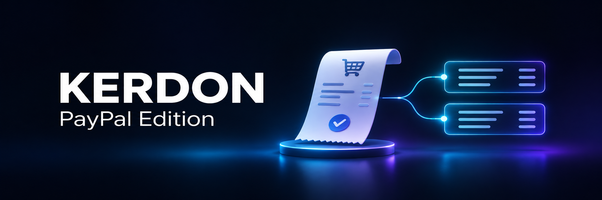
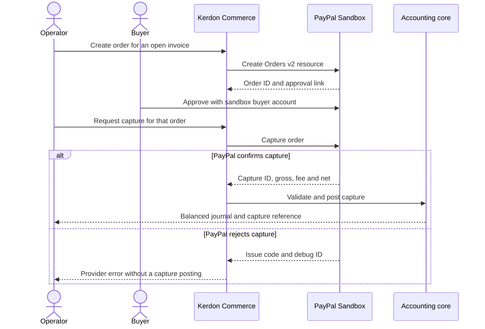
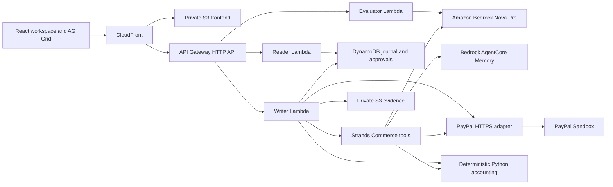

# Kerdon PayPal Edition

**Kerdon turns PayPal checkouts, subscriptions, disputes, and bills into a balanced double-entry ledger, seller commissions, and Four-Eyes governed payouts.**

[](https://github.com/upgradedev/kerdon-paypal-erp/actions/workflows/ci.yml)
[](https://developer.paypal.com/tools/sandbox/)
[](#architecture)
[](frontend/package.json)
[](LICENSE)

**[Open PayPal Commerce](https://d175u4e48xuu3p.cloudfront.net/#module=paypal)** · [Financial statements](https://d175u4e48xuu3p.cloudfront.net/#module=statements) · [Try the demo](#try-the-demo) · [Verification](#verification-and-sandbox-boundaries) · [Architecture](#architecture)

Built for the [PayPal AI Hackathon](https://paypalaihackathon.devpost.com/). The public workspace uses synthetic business data and PayPal Sandbox.

[Problem](#the-problem) · [Checkout flow](#how-a-checkout-becomes-a-journal) · [Build and test](#build-and-test) · [Docs and license](#documentation-and-license)

## The problem

Sofia Marinou, a finance operations director for a multi-store merchant, needs to tie each customer payment to the right invoice and explain the difference between gross sales and net cash. When fees, approvals and settlement records live in different systems, that reconciliation becomes a manual close task.

Kerdon links PayPal order and capture IDs to the invoice, then uses the provider's capture breakdown to clear receivables and post cash and fees in integer cents. A Strands agent on Amazon Bedrock Nova Pro can call PayPal tools from the same workspace. PayPal controls buyer authorization and returns provider status. The accounting core validates and posts the journal.

## Try the demo

1. Open **[PayPal Commerce](https://d175u4e48xuu3p.cloudfront.net/#module=paypal)** and choose **Verify Live OAuth2 Scopes** to check the sandbox connection.
2. Replace the suggested agent goal with **Inspect the Sandbox connection and summarize the account. Only use the status tool.** Choose **Run PayPal Strands Agent** and inspect the engine, tool results and provider mode.
3. Choose **Create Live Order v2** to create a sandbox order from an open invoice. The order row shows its PayPal ID and approval link. **Sync Status** reads the provider state.

The hosted workspace opens without a Kerdon account. To exercise the capture path, approve the order through **Approve on PayPal Sandbox** with a PayPal Sandbox buyer account, return to Kerdon and choose **Capture -> GL** on that order. Inspect the net cash, PayPal fee and cleared receivable in the commerce workspace, then open [Financial statements](https://d175u4e48xuu3p.cloudfront.net/#module=statements). The workspace also includes sample reconciled entries for exploring the grids without buyer credentials.

With the deployed merchant's Sandbox credentials in your shell, run `python scripts/verify_paypal_checkout.py ORDER_ID` to compare the provider's capture with the deployed settlement and journal. The check reads both systems and fails if either side is incomplete or the amounts differ.

## How a checkout becomes a journal



A confirmed capture debits **cash** for the net amount and **processing expense** for the fee. It credits **accounts receivable** for the gross amount. AG Grid shows the split, filters, totals and CSV export. The statements workspace reads the same ledger for the trial balance, cash flow and account cards.

## Verification and sandbox boundaries

| Surface | Evidence and scope |
|---|---|
| **Hosted release** | [Deployed SHA](https://d175u4e48xuu3p.cloudfront.net/DEPLOYED_SHA) and [verified CI run](https://github.com/upgradedev/kerdon-paypal-erp/actions/runs/43179283825) for `73699c8`. The run records 65 tests, 112 live API checks and automated axe checks on the exercised views at 375 and 1280 pixels. |
| **Checkout** | The live check creates a Sandbox order and verifies PayPal's `ORDER_NOT_APPROVED` response for premature capture. The buyer-approved posting path has [automated coverage](tests/test_paypal_live_suite.py). The workspace's sample entries are fixtures. |
| **Subscriptions and webhooks** | Sandbox resource creation covers products, plans, subscription approval links and webhook registration. Buyer approval is required to activate a subscription. Webhook signature checks are implemented separately from registration. |
| **Agent tools** | The hosted writer can run six Strands tools for inspection, checkout, subscriptions, webhooks and governed payouts. The response includes the engine, provider mode and tool results. AgentCore Memory stores an audit event. A deterministic fallback has a separate engine label. |
| **Payouts and disputes** | Payouts check role separation, evidence and available balance before a provider request. The observed sandbox rejection was `INSUFFICIENT_FUNDS`. Dispute sync reads the provider list, and evidence packets are available for review. |
| **Provider boundaries** | The PayPal integration targets Sandbox. Invoicing v2 payloads are previews. The public workspace uses demo identities and synthetic records. Use only sandbox accounts and sample data. |

## Architecture



The [PayPal adapter](src/kerdon_aws/paypal_live_client.py) owns OAuth and provider requests. The [commerce tools](src/kerdon_aws/paypal_agent_tools.py) call that adapter and the domain core. The [SAM template](infra/template.yaml) defines the deployment, including the three Lambda roles and the journal.

## Build and test

Use **Python 3.11+**. The local backend uses Python's standard library with synthetic fixtures.

```bash
git clone https://github.com/upgradedev/kerdon-paypal-erp.git
cd kerdon-paypal-erp
python scripts/verify_gates.py
python scripts/run_erp_benchmark.py
python scripts/serve_local.py 8080
```

Open [http://127.0.0.1:8080/](http://127.0.0.1:8080/) for the local workspace or check [local health](http://127.0.0.1:8080/health). With Sandbox credentials absent, the local connector reports `paypal-sandbox-simulated`. For the full React build, use Node.js 20+ and run `npm --prefix frontend ci` followed by `npm --prefix frontend run build`. CI builds and serves that bundle through the deployment defined in SAM.

For the Python tests, set `PYTHONPATH=src` and run `python -m unittest discover -s tests -v`. Keep `PAYPAL_CLIENT_ID` and `PAYPAL_CLIENT_SECRET` unset for offline tests. Supply your own Sandbox credentials through the server environment or CI secrets when exercising the real connector.

## Documentation and license

- [High-level design](docs/HLD.md) covers data, permissions and provider boundaries.
- [ERP workspace reference](docs/ERP_WORKSPACE.md) lists the user journeys, routes and deployment requirements.
- [Devpost submission copy](docs/DEVPOST.md) describes the hackathon entry.
- [MIT license](LICENSE) covers the original source and documentation.
