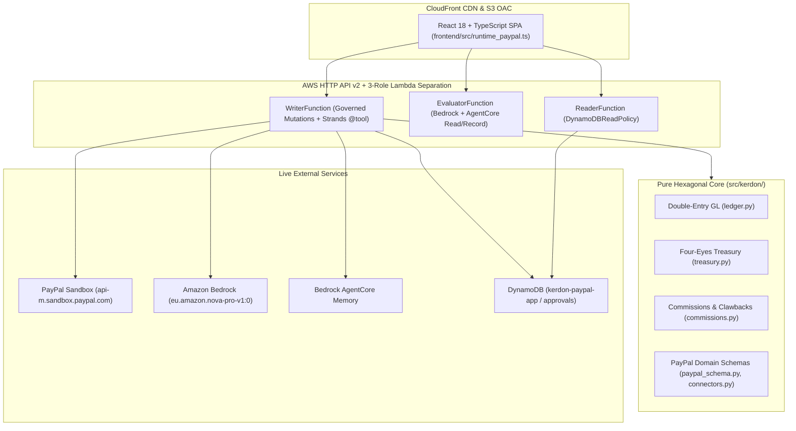
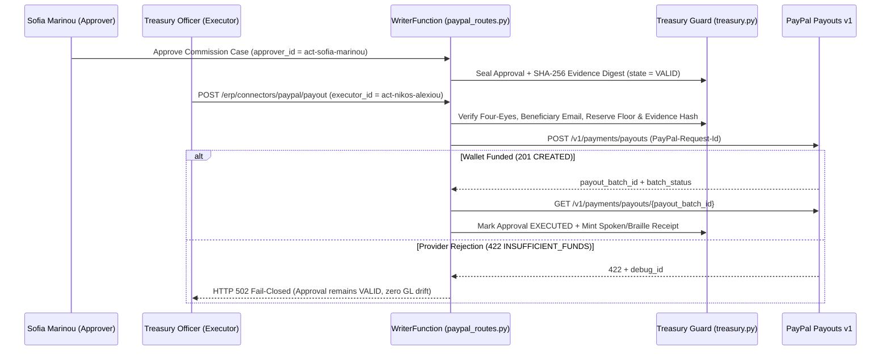

# High-Level Design (HLD): Kerdon PayPal Edition

## 1. Architectural Principles

1. **Deterministic Ledger Authority (`Gate A5`):** `src/kerdon/` owns all accounting, tax, commission, and treasury math in integer cents and imports zero network, clock, cloud, or LLM libraries.
2. **Fail-Closed Upstream PayPal Integration:** `src/kerdon_aws/paypal_live_client.py` communicates over HTTPS with `https://api-m.sandbox.paypal.com`. Upstream rejections (`ORDER_NOT_APPROVED`, `INSUFFICIENT_FUNDS`) raise `ExternalProviderError` (`HTTP 502`) carrying PayPal's `debug_id` and `issue` code while leaving General Ledger balances and `VALID` treasury approvals untouched.
3. **Least-Privilege Three-Role Compute (`Gate A7`):** Separate `ReaderFunction`, `EvaluatorFunction`, and `WriterFunction` AWS Lambda roles (`infra/template.yaml`) isolate read queries, non-mutating AI evaluations, and governed state mutations.

---

## 2. Hexagonal Component Topology

---

## 3. PayPal Agentic Tool & Four-Eyes Payout Sequence

---

## 4. Security, Replay Isolation & Accessibility

- **Secret Hygiene:** `PAYPAL_CLIENT_ID` and `PAYPAL_CLIENT_SECRET` are injected as `NoEcho: true` CloudFormation parameters (`infra/template.yaml`) from encrypted GitHub Actions Secrets and never exposed in client payloads; `SEC-01`..`SEC-10` (`scripts/security_audit.py`) plus `Bandit` and `pip-audit` run on every push.
- **Journal Replay Determinism:** Every mutating PayPal route records `_replay_provider_receipt` in the DynamoDB event journal (`src/kerdon_aws/paypal_routes.py`), guaranteeing zero outbound PayPal or Bedrock calls during cross-Lambda state hydration (`tests/test_kerdon_aws.py`, `tests/test_paypal_live_suite.py`).
- **Accessibility & EU AI Act Controls:** Verified `0` `axe-core` violations across mobile (`375px`) and desktop (`1280px`) viewports (`scripts/browser_qa.py`), keyboard-focusable `.table-wrap` regions, Spoken + ASCII Braille payout receipts, and full alignment with EU AI Act Article 10, Article 13, Article 14, Article 15, and Article 50.
