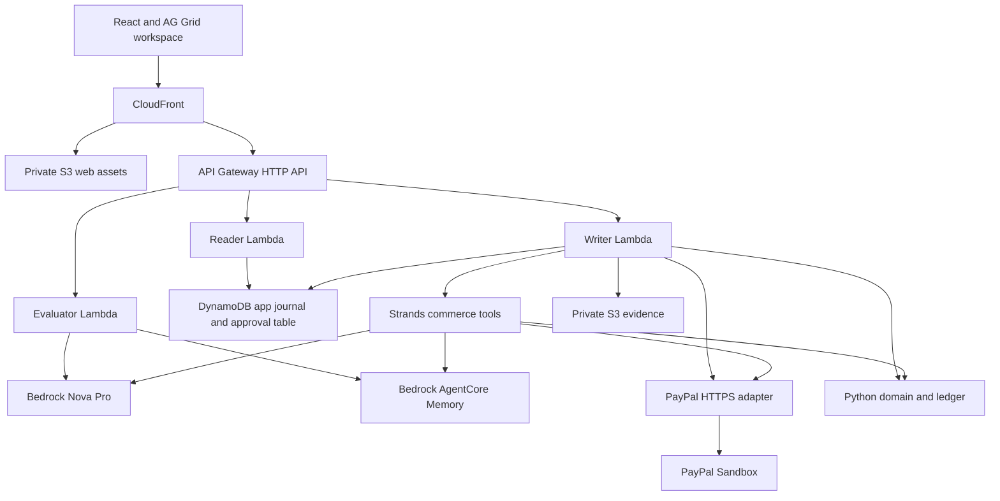
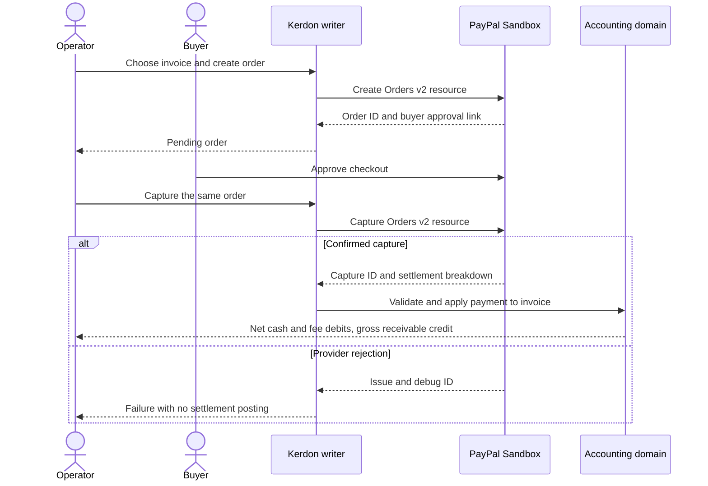

# High-level design

**Kerdon turns PayPal checkouts, subscriptions, disputes, and bills into a balanced double-entry ledger, seller commissions, and Four-Eyes governed payouts.**

For Sofia Marinou, the record of a payment must tie together a PayPal ID, an ERP invoice and balanced journal lines. The PayPal edition runs on the `kerdon-paypal-dev` stack in `eu-west-1`. The [public workspace](https://d175u4e48xuu3p.cloudfront.net/#module=paypal) uses Sandbox and synthetic business records.

## Components and trust boundaries

| Component | Responsibility |
|---|---|
| [PayPal HTTPS adapter](../src/kerdon_aws/paypal_live_client.py) | Obtains OAuth tokens, calls provider endpoints and returns structured results with resource IDs or a PayPal issue and debug ID. |
| [Strands commerce tools](../src/kerdon_aws/paypal_agent_tools.py) | Exposes inspection, checkout, subscription, webhook and payout tools. The response includes the runtime mode, tool results and audit-memory status. |
| [Accounting domain](../src/kerdon/) | Validates invoice, ledger, treasury and commission rules. Monetary arithmetic uses integer cents. The model operates through tools and does not author journal amounts. |
| [Persistence adapter](../src/kerdon_aws/persistence.py) | Reads and writes the DynamoDB journal and approval records. Supported replay paths rebuild state from recorded provider results. Evidence bytes are stored in S3. |
| [SAM deployment](../infra/template.yaml) | Separates Reader, Evaluator and Writer roles. CloudFront serves the web bundle from private S3 and routes API requests to API Gateway. |

## Order and capture

Creating an order persists its provider reference without clearing the invoice. The capture path reads the PayPal settlement breakdown and posts the journal against the linked invoice. PayPal request IDs and the recorded capture reference support safe retry handling. Automated tests cover successful and repeated capture responses. The live agent proof is an order in the buyer-approval stage. [Checkout tests](../tests/test_paypal_live_suite.py)

## Payouts, disputes and subscriptions

- **Payouts.** Treasury preflight checks approval state, evidence, actor separation, beneficiary and reserve floor before the Sandbox request. A late credit note can invalidate a pending approval. The observed Sandbox response was `INSUFFICIENT_FUNDS`, and the approval remained valid for review.
- **Disputes.** The connector reads the provider's dispute list. The workspace can prepare evidence and record related commission adjustments for review.
- **Subscriptions and webhooks.** Products, plans and approval links can be created in Sandbox. Subscription activation depends on buyer approval. Webhook registration and signature validation are distinct operations.
- **Invoicing.** The adapter can build an Invoicing v2 preview payload. The checkout flow uses Orders v2.

## Deployment and verification

The public stack uses demo identities. Hosted review therefore uses Sandbox accounts and synthetic data. A customer deployment requires an authenticated identity provider and server-side membership enforcement. PayPal credentials are passed to CloudFormation as `NoEcho` parameters from CI secrets. The template configures separate app and approval tables, private evidence storage and AgentCore Memory.

The table records design controls relevant to the listed AI Act topics and the deployment work that remains.

| Topic | Design control | Remaining work |
|---|---|---|
| Article 10, data governance | Sample business records and content hashes for evidence. | Define production data sources, access and retention. |
| Article 13, transparency | Engine and provider mode in the tool response. | Carry that provenance into external-facing exports where appropriate. |
| Article 14, human oversight | PayPal buyer approval and treasury preflight. | Bind production reviewers to authenticated identities. |
| Article 15, accuracy and resilience | Integer-cent checks, provider error handling and automated regression tests. | Measure production behavior under concurrent load and provider failures. |
| Article 50, transparency of generated content | Agent narration is presented with its engine and tool results. | Review how generated text is labelled when shared outside the workspace. |

[Deployment and test commands](ERP_WORKSPACE.md) · [Hosted release evidence](https://github.com/upgradedev/kerdon-paypal-erp/actions/runs/43179283825)